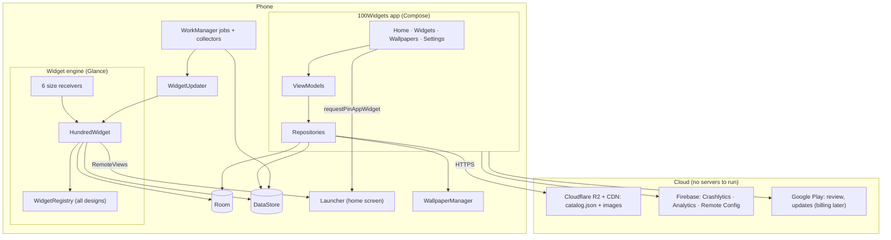
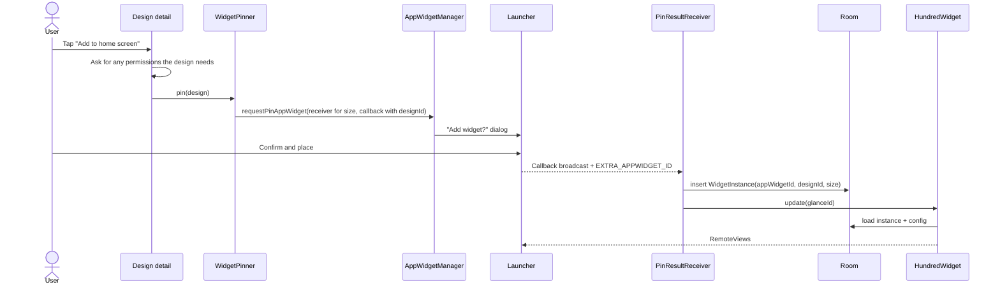
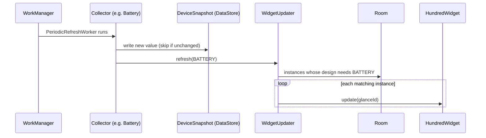
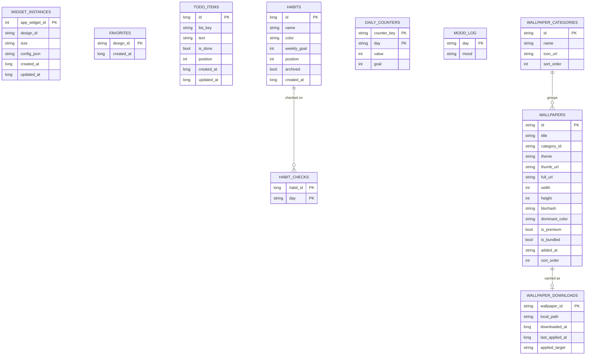

# 100Widgets

A themed home-screen widget and wallpaper app for Android. Users pick a theme, set its matching wallpaper, and drop its widgets onto the home screen.

> **Status: early development.** 22 designs across 6 themes **build, pass unit tests and lint, and run on a real phone** (Nothing A142P, Android 15, checked 2026-11-01). See [What exists in code today](#what-exists-in-code-today). The rest of this README describes the target design. Update it whenever a decision changes or code lands. Last updated: 2026-11-01.

---

## Contents

1. [The idea](#1-the-idea)
2. [Decisions so far (v1 scope)](#2-decisions-so-far-v1-scope)
3. [Source material](#3-source-material)
4. [The app: four sections](#4-the-app-four-sections)
5. [Themes and widget inventory](#5-themes-and-widget-inventory)
6. [How Android widgets work (and what that means for our designs)](#6-how-android-widgets-work-and-what-that-means-for-our-designs)
7. [Tech stack](#7-tech-stack)
8. [Architecture](#8-architecture)
9. [Codebase layout](#9-codebase-layout)
10. [Widget engine](#10-widget-engine)
11. [Data sources and refresh](#11-data-sources-and-refresh)
12. [Database and storage](#12-database-and-storage)
13. [Wallpapers system](#13-wallpapers-system)
14. [Permissions](#14-permissions)
15. [Monetization](#15-monetization)
16. [Analytics, crash reporting and remote config](#16-analytics-crash-reporting-and-remote-config)
17. [Build, run and test](#17-build-run-and-test)
18. [Release and Play Store checklist](#18-release-and-play-store-checklist)
19. [Roadmap](#19-roadmap)
20. [Open decisions](#20-open-decisions)
21. [Glossary](#21-glossary)

---

## 1. The idea

**What:** an Android app with a large library of good-looking home-screen widgets and wallpapers, organised into **themes**. Each theme has its own visual language (fonts, colours, shapes), a matching wallpaper, and a set of widgets designed to sit together on one home screen.

**Why it can stand out:** most widget apps sell widgets one at a time. 100Widgets sells **scenes**: a full, coordinated home screen (wallpaper plus widgets) that the app helps you set up in a couple of minutes.

**Name:** "100Widgets". The canvas has exactly 100 designs across 6 themes. v1 ships a subset (see [section 5](#5-themes-and-widget-inventory)), and the catalogue grows past 100 through updates.

**Inspiration:** a screen recording of an existing "glass widgets" app (dark UI, category list, size tabs, wallpaper grid, settings with purchase verification). We borrow the information architecture, not its look or branding.

**Platform:** Android only, distributed on Google Play.

---

## 2. Decisions so far (v1 scope)

| Topic | Decision | Notes |
|---|---|---|
| Themes at launch | **6 themes**: Horizon, Noir, Paper, Signal, Bauhaus, Comic | **Paper and Signal ship only their designs that need no special permission** (decided 2026-11-01). Their permission designs (brightness, DND, screen time, steps, coordinates) stay out of v1 to keep the permission list short for Play review. |
| Weather | **Not in v1** | Every weather widget is marked *Later*. Bauhaus faces that show a temperature show battery % instead until weather ships. No weather API, no API key, no location for weather. |
| Money | **Free** at launch, no ads | Pro version and/or ads may come later. The code keeps a `Tier` flag on every design and an `EntitlementRepository` so adding them later is not a refactor ([section 15](#15-monetization)). |
| Backend | **No server** | Static files on Cloudflare R2 (wallpapers) + Firebase (crash reports, analytics, remote config). |
| Language/UI | Kotlin, Jetpack Compose (app), Jetpack Glance (widgets) | Widgets must be native, so cross-platform frameworks add nothing. |
| Android versions | minSdk 26, targetSdk 36 | Some widget features (rounded corners, responsive sizes, check boxes, custom clock hands) need Android 12 (API 31) and have fallbacks below. |
| Process | Discuss the plan before any commit | See `CLAUDE.md`. |

### What exists in code today

| Area | Done | Not yet |
|---|---|---|
| Build | 7 Gradle modules, version catalog (`gradle/libs.versions.toml`, October 2026 stable versions), Gradle wrapper, Hilt, KSP, Room schema export. `assembleDebug`, `test` and `lint` pass (lint's only warning: targetSdk 36 is not the newest, see §20) | `build-logic/` convention plugins, CI, a run on a real phone |
| Widget engine | `HundredWidget` (one GlanceAppWidget for all sizes), 6 size receivers + widget info XML, `WidgetPinner` + `PinResultReceiver`, `WidgetUpdater` (refresh by data source, reconcile), error and "tap to choose" layouts | Responsive sizes (uses `SizeMode.Single`), generated picker previews |
| Designs (22) | Horizon 1, Noir 2, Paper 4, Signal 6, Bauhaus 1, Comic 8 (rows marked **built** in §5); real theme fonts; pre-rendered Comic art | About 50 more v1 designs. Next batch needs new storage or a settings screen: to-dos, mood, water, countdown, time zone, alarm, daily strip, signal strength, battery saver. A midnight `DATE` refresh job (date-derived text updates on the next widget redraw today) |
| Data | Room `widget_instances` + `favorites`, settings DataStore, `DeviceSnapshot` store, battery collector, `RefreshWorker`, `WidgetRefreshCoordinator` | Calendar, steps, alarm and DND collectors; to-do/habit/mood tables |
| App | Four tabs (Home with a snapping scenes carousel, Widgets catalogue with live previews on wallpaper backdrops, Wallpapers with 30 bundled wallpapers in 5 collections (Glass, Landscapes, Clay, Clay Night, Scenes) as sideways-scrolling rows of thumbnails and a full-screen preview, Settings grouped into Appearance, Widgets, Help and About), design detail with an add-widget sheet, design chooser (`ConfigureActivity`). Motion system, shared-element transitions, haptics and reduced-motion support (`app/ui/motion`). Design system (Inter type scale, spacing, radius and colour tokens in `app/ui/theme/Theme.kt`) with Light, Dark and System modes chosen in Settings (rules in [`docs/ux-guide.md`](docs/ux-guide.md)) | Apply-scene checklist, online wallpaper catalogue, permissions screens, Firebase |
| Tests | `InstanceConfigTest`, `WidgetRegistryTest`, `EngineContractTest` (10 tests, all passing) | Glance, Room migration, screenshot tests |

---

## 3. Source material

| Source | What it holds | Where |
|---|---|---|
| Design canvas "Widget Scenes v2" | 16 interactive home-screen boards (412×892), 6 themes, 100 widget designs as HTML/CSS. **This is the visual spec** for every widget. | https://claude.ai/artifact/Wh2Ta3aPcmEG3qVz6RXio8 |
| `widget-scenes-wallpapers.zip` | 6 theme wallpapers + 9 photo tiles used inside widgets | Kept outside the repo for now (see table below) |
| Inspiration video | Screen recording of an existing glass-widgets app | Kept outside the repo |

### Assets in the zip

| File | Pixels | Used for | v1 |
|---|---|---|---|
| `hz-wall.jpg` | 824×1784 | Horizon wallpaper | Yes (bundled as `wp_horizon.webp`), re-export at 1440×3200+ |
| `nr-wall.jpg` | 824×1784 | Noir wallpaper | Yes (`wp_noir.webp`), re-export |
| `pa-wall.jpg` | 824×1784 | Paper wallpaper | Deferred |
| `sg-wall.jpg` | 824×1784 | Signal wallpaper | Deferred |
| `ba-wall.jpg` | 824×1784 | Bauhaus wallpaper | Yes (`wp_bauhaus.webp`), re-export |
| `cm-wall.jpg` | 824×1784 | Comic wallpaper | Yes (`wp_comic.webp`), re-export |
| `hz-peak.jpg` | 640×640 | Horizon "Greeting photo" tile | Yes |
| `hz-range.jpg` | 960×480 | Horizon "Quote over ridge" tile | Yes |
| `hz-mist.jpg` | 720×400 | Horizon "Clock over mist" tile | Yes |
| `hz-dawn.jpg` | 720×400 | Horizon "Clock over dawn" tile | Yes |
| `hz-night.jpg` | 480×480 | Horizon night tile | Spare |
| `nr-forest.jpg` | 960×480 | Noir "Misty pines" photo widget | Yes |
| `nr-ink.jpg` | 960×480 | Noir "Ink in water" photo widget | Yes |
| `cm-city.jpg` | 600×600 | Comic "City at night" panel | Yes |
| `cm-rain.jpg` | 600×600 | Comic "Rain panel" (weather) | Later |

**Wallpaper resolution:** modern phones are 1080×2400 to 1440×3200. The current 824×1784 files will look soft. Masters should be at least 1440×3200 (ideally 2160 wide for tablets and parallax).

**Art rules:** original art only. No licensed characters, logos or fan art (a common reason wallpaper apps get removed from Play). The canvas already follows this.

### Fonts used by the designs (all Google Fonts, OFL licensed, OK to bundle)

| Theme | Fonts |
|---|---|
| Horizon | Inter |
| Noir | Archivo (condensed widths), Geist |
| Bauhaus | Space Grotesk, Space Mono |
| Comic | Bangers, Comic Neue |
| Paper (deferred) | Geist |
| Signal (deferred) | Doto, Space Mono, Instrument Serif |

All of these are bundled in `widget/designs/src/main/res/font/` as fixed-weight, Latin-only cuts (776 KB in total), with their licences in `assets/licenses/fonts-OFL.txt`. Widgets use them through `WidgetFont` (TextClock and TextView layouts per font). Confirmed rendering on the Nothing launcher; Pixel, Samsung and Xiaomi still to check. The app's own UI also uses Inter (Regular, Medium, SemiBold, Latin-only, about 170 KB) from `app/src/main/res/font/`, under the same OFL licence file.

---

## 4. The app: four sections

Bottom navigation with four tabs: **Home**, **Widgets**, **Wallpapers**, **Settings**. Light and dark modes (Settings → Appearance → Theme, default System); widgets keep their own theme colours in both. The app's own look should be its own identity, not a copy of the inspiration app.

### Home
- **Scenes carousel:** one card per theme, showing the full home-screen mockup from the canvas.
- **Scene detail → "Apply scene":** a guided checklist:
  1. Set the theme wallpaper (home, lock or both).
  2. Add each widget in the scene, one at a time, via the system "Add widget?" dialog.
  3. Tick-off state is derived from which designs the user has actually placed.

  Android does not let apps place widgets at exact positions, so the user drops each one where the mockup shows it.
- **Newly added:** designs whose `addedIn` equals the current app version.
- **Your widgets:** widgets currently on the home screen (tap to change design or settings).
- **Tips card:** for example "Widgets not updating? Turn off battery optimisation for 100Widgets" with brand-specific steps.

### Widgets
- Search, theme filter chips, size chips (1×1, 1×2, 2×1, 2×2, 4×1, 4×2) and a category list (Clock, Calendar, Photo, To-do, Battery, Controls, Shortcuts, Health, Usage, Search, Utility).
- **Design detail page:**
  - live preview over the theme wallpaper
  - size
  - which permissions it needs, and why
  - favourite button
  - **Add to home screen**

### Wallpapers
- One section per collection (name, count, tagline) with a sideways-scrolling row of thumbnails. Rows only load small thumbnails (`wpt_*`); the full image loads in the preview.
- Full-screen preview with a fake clock overlay, then **Set as: Home / Lock / Both**.
- Theme wallpapers link to "Widgets that match".

### Settings
- **Widget updates:** refresh interval (15 / 30 / 60 min).
- **Clock format:** system / 12-hour / 24-hour.
- **Permissions overview:** status of every special access, with buttons to grant or revoke.
- **Keep widgets updating:** battery-optimisation help per phone brand.
- **Privacy:** analytics on/off, privacy policy link.
- What's new, share a widget idea, rate the app (Play In-App Review), contact and socials, about and version.
- **Later:** restore purchases, remove ads.

### Navigation routes (planned)

| Route | Screen |
|---|---|
| `home` | Home tab |
| `scene/{themeId}` | Scene detail + apply checklist |
| `widgets` | Widgets tab (catalogue) |
| `widgets/category/{categoryId}` | Category list |
| `widgets/design/{designId}` | Design detail |
| `wallpapers` | Wallpapers tab |
| `wallpapers/{wallpaperId}` | Wallpaper preview |
| `settings` | Settings tab |
| `settings/permissions` | Permissions overview |
| `settings/battery-help` | Keep widgets updating |
| `configure?appWidgetId=` | Design chooser (launched by the launcher, separate activity) |

---

## 5. Themes and widget inventory

Each row is one **design** (a widget the user can add). IDs are permanent because they are stored on users' phones: never rename one, only deprecate it.

**Status legend:**

| Status | Meaning |
|---|---|
| **Ready** | Works with local data, no permission |
| **Permission** | Works once the user grants the named permission |
| **Adapt** | Changed from the canvas to fit Android limits (the note says how) |
| **Later** | Not in v1 (weather, media, or no allowed Android API) |

Board codes: H1 = Horizon board 1 (canvas `Main.dc.html`), H2 = `Horizon-2`, N1 = `Noir-1`, and so on.

v1 themes are Horizon, Noir, Paper, Signal, Bauhaus and Comic. Paper and Signal ship only their designs that need no permission. Designs marked **built** exist in code today.

### Horizon: frosted glass · Inter · wallpaper `hz-wall`

| ID | Widget | Size | Board | Status | Notes |
|---|---|---|---|---|---|
| `horizon.clock_quote` | Clock & quote | 2×2 | H1 | Ready | TextClock date + time, quote from bundled list (**built**) |
| `horizon.greeting_photo` | Greeting photo | 2×2 | H1 | Ready | `hz-peak` tile, "Good morning / afternoon / evening / night" switches at 05, 12, 17, 21 |
| `horizon.weather_tall` | Weather (city) | 1×2 | H1 | Later | Weather |
| `horizon.quick_toggles` | Quick toggles | 1×2 | H1 | Adapt | Torch really toggles. Wi-Fi and Bluetooth open the system panel (apps can't toggle them since Android 10 / 13) |
| `horizon.agenda` | Today's agenda | 2×2 | H1 | Permission | Calendar |
| `horizon.quote_ridge` | Quote over ridge | 4×2 | H1 | Ready | `hz-range` tile, tap ↻ for next quote |
| `horizon.clock_mist` | Clock over mist | 2×2 | H2 | Ready | `hz-mist` tile |
| `horizon.stacked_clock` | Stacked clock | 2×2 | H2 | Ready | Hour over minute (two TextClocks) |
| `horizon.analog` | Analog clock | 2×2 | H2 | Ready | AnalogClock. Custom hands + second hand on Android 12+, simpler dial below |
| `horizon.clock_dawn` | Clock over dawn | 2×2 | H2 | Ready | `hz-dawn` tile |
| `horizon.weather_hourly` | Hourly weather | 4×2 | H2 | Later | Weather |
| `horizon.weather_pill` | Weather summary | 2×1 | H2 | Later | Weather |
| `horizon.calendar_events` | Month + today's events | 4×2 | H3 | Permission | Calendar (the month grid alone needs none) |
| `horizon.checklist` | Today's checklist | 2×2 | H3 | Ready | `todo_items`. Check boxes on Android 12+, tappable icons below |
| `horizon.week_progress` | This week's progress | 2×2 | H3 | Ready | Habits (`habits`, `habit_checks`) |
| `horizon.now_playing` | Now playing | 4×2 | H3 | Later | Needs notification access (media) |
| `horizon.batteries` | Device batteries | 4×1 | H3 | Adapt | Phone battery only. Android has no public API for earbud/watch battery |

### Noir: black on grey · Archivo + Geist · wallpaper `nr-wall`

| ID | Widget | Size | Board | Status | Notes |
|---|---|---|---|---|---|
| `noir.search` | Search bar | 4×1 | N1 | Ready | Opens web search / voice search |
| `noir.photo_pines` | Photo: misty pines | 4×2 | N1 | Ready | `nr-forest` |
| `noir.condensed_clock` | Condensed clock | 2×2 | N1 | Adapt | The canvas stretches the font 1.72× vertically. Widgets can't scale text, so use a bundled tall condensed font (**built**, system condensed font for now) |
| `noir.app_stack` | App stack | 2×2 | N1 | Ready | 9 user-picked apps |
| `noir.photo_ink` | Photo: ink in water | 4×2 | N2 | Ready | `nr-ink` |
| `noir.battery` | Battery | 2×2 | N2 | Ready | (**built**) |
| `noir.mantra` | Mantra | 2×1 | N2 | Ready | Tap for next |
| `noir.radio` | Radio "Slow Morning" | 2×1 | N2 | Later | Media playback |
| `noir.weather` | Weather (city) | 2×1 | N2 | Later | Weather |
| `noir.alarm` | Alarm | 2×1 | N2 | Adapt | Shows the next system alarm (read-only), tap opens the clock app. Apps can't switch another app's alarms on/off |
| `noir.date` | Date | 1×1 | N3 | Ready | TextClock date format |
| `noir.art_waves` | Waves art tile | 2×2 | N3 | Ready | Decorative |
| `noir.month` | Month calendar | 2×2 | N3 | Ready | Grid rebuilt at midnight |
| `noir.wifi_dnd` | Wi-Fi + Do not disturb | 2×1 | N3 | Adapt | Wi-Fi opens the panel. DND toggles with DND access (Permission) |
| `noir.analog_mini` | Analog clock | 1×1 | N3 | Ready | |
| `noir.activity` | Activity (kcal, stand, minutes) | 2×1 | N3 | Later | Needs Health Connect. Could become steps-only |
| `noir.vinyl` | Vinyl player | 2×2 | N3 | Later | Media |

### Paper: ink & colour · Geist · wallpaper `pa-wall`

| ID | Widget | Size | Board | Status | Notes |
|---|---|---|---|---|---|
| `paper.analog` | Analog clock | 2×2 | P1 | Ready | (**built**) |
| `paper.brightness` | Brightness slider | 1×2 | P1 | Permission | "Modify system settings". Tap cycles levels |
| `paper.dnd` | Do not disturb | 1×1 | P1 | Permission | DND access |
| `paper.signal` | Signal strength | 1×1 | P1 | Adapt | Refreshed periodically, not live |
| `paper.weather` | Weather + forecast | 4×2 | P1 | Later | Weather |
| `paper.volume` | Volume slider | 1×2 | P1 | Ready | Tap cycles media volume (**built**) |
| `paper.ringer` | Ringer | 1×1 | P1 | Permission | Silent needs DND access. Vibrate/normal don't |
| `paper.screen_record` | Screen record | 1×1 | P1 | Later | No public way to start the system recorder; would need our own recorder |
| `paper.battery` | Battery | 2×2 | P1 | Ready | (**built**) |
| `paper.power` | Power switch | 2×1 | P1 | Later | Apps can't power the phone off. Only an accessibility service can open the power menu, which Play restricts |
| `paper.sleep` | Sleep mode | 2×1 | P1 | Adapt | Toggles Do not disturb (Permission: DND access) |
| `paper.schedule` | Today's schedule | 4×2 | P2 | Permission | Calendar |
| `paper.compass` | Compass | 2×2 | P2 | Adapt | Widgets can't show a live compass. Decorative dial, tap rotates it (**built**) |
| `paper.now_playing` | Now playing | 2×3 | P2 | Later | Media (also the only 2×3 design) |
| `paper.recorder` | Recorder | 2×1 | P2 | Later | Needs an in-app recorder |
| `paper.todo` | Today's to-do list | 2×2 | P2 | Ready | `todo_items` |
| `paper.water` | Water intake | 2×2 | P2 | Ready | Tap adds 250 ml, resets daily (`daily_counters`) |

### Signal: dots & red · Doto, Space Mono, Instrument Serif · wallpaper `sg-wall`

| ID | Widget | Size | Board | Status | Notes |
|---|---|---|---|---|---|
| `signal.steps` | Steps + streak | 2×2 | S1 | Permission | Activity recognition |
| `signal.analog` | Analog clock | 2×2 | S1 | Ready | (**built**) |
| `signal.screen_time` | Screen time today | 2×2 | S1 | Permission | Usage access |
| `signal.app_limit` | App limit exceeded | 2×2 | S1 | Permission | Usage access. Limits set in the app (`app_limits`) |
| `signal.torch` | Torch | 2×1 | S1 | Ready | (**built**) |
| `signal.recorder` | Recorder | 2×2 | S1 | Later | Needs an in-app recorder |
| `signal.dnd` | Do not disturb | 2×1 | S1 | Permission | DND access |
| `signal.weather` | Weather + 5 days | 4×2 | S2 | Later | Weather |
| `signal.dot_clock` | Dot clock | 1×2 | S2 | Ready | Doto dot-matrix font (verify in the font spike) (**built**) |
| `signal.date` | Today's date | 2×2 | S2 | Ready | (**built**) |
| `signal.auto_rotate` | Auto rotate | 1×1 | S2 | Permission | "Modify system settings" |
| `signal.location` | Location toggle | 1×1 | S2 | Adapt | Apps can't toggle location. Opens location settings (**built**) |
| `signal.time_zone` | Day + time zone | 2×2 | S2 | Ready | TextClock with a user-picked time zone |
| `signal.compass` | Compass | 2×2 | S2 | Adapt | Same as `paper.compass` (**built**) |
| `signal.countdown` | Next flight → Countdown | 4×2 | S3 | Adapt | No flight data source. Becomes a countdown to an event the user enters |
| `signal.mic` | Microphone access | 2×2 | S3 | Later | No API to toggle the mic. At most a privacy-settings shortcut |
| `signal.battery_mode` | Battery mode | 2×2 | S3 | Adapt | Shows Battery Saver on/off, tap opens battery settings |
| `signal.earbuds` | Earbuds | 2×2 | S3 | Later | No public earbud battery API |
| `signal.coordinates` | Current coordinates | 2×2 | S3 | Adapt | Location is read only when the user taps (foreground). No background location (Permission: location) |

### Bauhaus: watch faces · Space Grotesk + Space Mono · wallpaper `ba-wall`

| ID | Widget | Size | Board | Status | Notes |
|---|---|---|---|---|---|
| `bauhaus.split_clock` | Split clock | 2×2 | B1 | Ready | TextClock hh / mm |
| `bauhaus.date_two_dials` | Date + two dials | 2×2 | B1 | Adapt | Dials rebuilt as AnalogClock hands, date via TextClock |
| `bauhaus.radial_seconds` | Radial clock with seconds | 2×2 | B1 | Adapt | A seconds ring can't update live. Rebuilt as AnalogClock with a second hand (Android 12+) |
| `bauhaus.word_clock` | Clock in words | 2×2 | B1 | Later | Words need a redraw every few minutes, which widgets can't do reliably |
| `bauhaus.grey_dial` | Grey dial | 2×2 | B1 | Ready | AnalogClock + TextClock |
| `bauhaus.large_type` | Date + time in large type | 2×2 | B2 | Ready | TextClock. The ordinal suffix ("25th") is dropped: TextClock has no ordinal format |
| `bauhaus.poster_clock` | Poster clock | 2×2 | B2 | Ready | |
| `bauhaus.concentric` | Concentric clock | 2×2 | B2 | Adapt | Rings become rotating AnalogClock hand drawables |
| `bauhaus.time_date_temp` | Time, date + temperature | 2×2 | B2 | Adapt | Temperature slot shows battery % until weather ships |
| `bauhaus.white_disc` | Analog on white disc | 2×2 | B2 | Ready | (**built**) |
| `bauhaus.four_dials` | Four dials (h, m, s, battery) | 2×2 | B3 | Adapt | Progress dials rebuilt as hands, seconds via second hand (Android 12+) |
| `bauhaus.big_dial_stats` | Big dial + day stats | 2×2 | B3 | Permission | AnalogClock + steps (activity recognition). kcal estimated from steps |
| `bauhaus.circles` | Date, minute + temperature circles | 2×2 | B3 | Adapt | Temperature → battery |
| `bauhaus.shape_poster` | Shape poster | 2×2 | B3 | Ready | Tap reshuffles |
| `bauhaus.pies` | Hour/minute/second pies + battery | 2×2 | B3 | Later | Pie fills need constant redraws |
| `bauhaus.striped_clock` | Striped clock | 2×2 | B3 | Ready | TextClock over a striped image |

### Comic: inked panels · Bangers + Comic Neue · wallpaper `cm-wall`

Tilted stickers, halftone dots and starbursts are pre-rendered images. Only text that changes is live.

| ID | Widget | Size | Board | Status | Notes |
|---|---|---|---|---|---|
| `comic.masthead` | The Daily Issue | 4×1 | C1 | Ready | Issue number = day of year, redrawn at midnight (**built**) |
| `comic.city_panel` | City at night | 2×2 | C1 | Ready | `cm-city` tile, "Meanwhile, at …" caption via TextClock (**built**) |
| `comic.sound_effect` | Sound effect | 2×2 | C1 | Ready | Tap for the next word; the 5 words are pre-rendered (**built**) |
| `comic.bubble_clock` | Speech bubble clock | 2×2 | C1 | Ready | TextClock in the bubble, date sticker redrawn at midnight (**built**) |
| `comic.calendar_page` | Calendar page | 2×2 | C1 | Ready | Month, day and weekday are TextClocks (**built**, condensed system font until Bangers is bundled) |
| `comic.weather` | Weather | 2×1 | C1 | Later | Weather |
| `comic.battery` | Battery | 2×1 | C1 | Ready | (**built**) |
| `comic.to_be_continued` | To be continued | 2×1 | C1 | Ready | Days to Saturday, redrawn at midnight (**built**) |
| `comic.alarm` | Alarm | 1×1 | C1 | Adapt | Same as `noir.alarm` |
| `comic.daily_strip` | Daily strip | 4×2 | C2 | Ready | "NOW!" moves between the 7 AM / 1 PM / 9 PM panels at time-of-day boundaries |
| `comic.todo_bubble` | To-do thought bubble | 2×2 | C2 | Ready | `todo_items` |
| `comic.rain_panel` | Rain panel | 2×2 | C2 | Later | Weather |
| `comic.mixtape` | Mixtape | 2×1 | C2 | Later | Media |
| `comic.steps` | Steps today | 2×1 | C2 | Permission | Activity recognition |
| `comic.mood` | Mood picker | 4×1 | C2 | Ready | `mood_log` |
| `comic.search` | Search | 4×1 | C2 | Ready | Same as `noir.search` (**built**) |
### Theme extras: app tiles

Each board also has small themed app icons. They become one **App tile** design per theme (`horizon.app_tile`, `noir.app_tile`, `bauhaus.app_tile`, `comic.app_tile`): 1×1, the user picks the app and the theme draws the icon. Status: Ready.

### Counts (v1 themes)

| Theme | Designs | Ready | Permission | Adapt | Later | **v1** |
|---|---|---|---|---|---|---|
| Horizon | 17 | 9 | 2 | 2 | 4 | **13** |
| Noir | 17 | 10 | 0 | 3 | 4 | **13** |
| Bauhaus | 16 | 7 | 1 | 6 | 2 | **14** |
| Comic | 16 | 11 | 1 | 1 | 3 | **13** |
| App tiles | 4 | 4 | 0 | 0 | 0 | **4** |
| **Total** | **70** | 41 | 4 | 12 | 13 | **57** |
| Paper (permission-free) | 17 | 5 | — | 2 | — | **7** |
| Signal (permission-free) | 19 | 5 | — | 4 | — | **9** |

**Path to 100+:** Paper (+12) and Signal (+15) once their permissions are worth it, weather designs (+8), media designs (+5), plus new designs in updates.

---

## 6. How Android widgets work (and what that means for our designs)

The canvas designs are HTML/CSS. **Android widgets cannot run HTML.** A widget is a `RemoteViews` tree: a small, fixed set of Android views that our app describes and the **launcher** (a different app) draws. Every design is rebuilt natively, with the canvas as the visual reference.

### What translates and what doesn't

| In the canvas | On Android |
|---|---|
| Layout, colours, rounded cards, SVG icons | Works. SVG icons become VectorDrawables |
| Live clock / date | Works via `TextClock` / `AnalogClock`. The launcher ticks them, so it costs zero battery and needs zero app wake-ups |
| Taps (next quote, check box, add water) | Works via Glance actions (`actionRunCallback`, `actionStartActivity`) |
| `backdrop-filter: blur` glass | **Not possible.** A widget can't see the wallpaper behind it. Faked with a translucent fill, a 1 dp light border and an optional noise texture |
| Custom fonts | Glance's `Text` can't use bundled fonts. XML layouts with `android:fontFamily="@font/…"` usually work on Android 8+ (to be verified per launcher in Phase 0). Fallback: render text to a bitmap |
| Halftone, starbursts, drop shadows, gradients-as-art | Pre-rendered PNG/WebP or vector backgrounds |
| CSS transforms (rotate, scale) on live text | Not supported. Static rotated art is pre-rendered |
| Animations | None |
| Per-second / per-minute custom drawing | Not reliable. Use TextClock/AnalogClock or redesign ([section 10.5](#105-clock-rendering-strategy)) |
| Toggling Wi-Fi / Bluetooth / location / mobile data | Blocked for apps. Open the system panel instead |

### Hard limits to design around

- **Refresh rate:**
  - `updatePeriodMillis` can't be shorter than 30 minutes.
  - WorkManager periodic work can't be shorter than 15 minutes.
  - Doze and phone-brand battery savers delay both.
- **Bitmap memory:** the total bitmap size in one widget update is capped (about screen width × height × 4 bytes × 1.5). Size every image to the widget, not the screen.
- **No network in a widget:** images must be bundled or downloaded by the app beforehand.
- **Launcher grids differ:** 4 or 5 columns, different cell sizes. Designs must be responsive (Glance `SizeMode.Responsive`).
- **Brand battery savers:** Xiaomi, Vivo, Oppo, Realme and some Samsung settings kill background work, so widgets go stale. The Settings help screen explains how to whitelist the app.
- **Placement:** apps can request a widget be added (`requestPinAppWidget`, Android 8+), but the user always confirms and chooses the position. Some launchers don't support it at all.

---

## 7. Tech stack

Pin exact versions in `gradle/libs.versions.toml` using the latest stable releases at project start.

| Layer | Choice | Why |
|---|---|---|
| Language | Kotlin (K2 compiler) | Android standard |
| App UI | Jetpack Compose + Material 3 | Modern, fast to build |
| Widgets | Jetpack Glance (`glance-appwidget`) | Compose-style API that produces RemoteViews. `AndroidRemoteViews` interop for TextClock/AnalogClock XML |
| Architecture | MVVM + unidirectional data flow (`StateFlow`) | Testable, standard |
| DI | Hilt | Standard. Glance/receivers use `@EntryPoint` |
| Async | Kotlin Coroutines + Flow | |
| Local DB | Room (with KSP) | Widget instances, to-dos, habits, wallpaper catalogue |
| Settings / snapshots | DataStore (Preferences + typed JSON) | |
| Background | WorkManager | Periodic refresh, content-URI triggers, midnight jobs |
| Network | Ktor client (or Retrofit) + kotlinx.serialization | Only for the wallpaper catalogue and images |
| Images | Coil 3 | Thumbnails, blurhash placeholders, disk cache |
| Navigation | Navigation Compose (type-safe routes) | |
| Crash / analytics / config | Firebase Crashlytics, Analytics, Remote Config | |
| Play integration | In-App Review, In-App Updates (Billing Library later) | |
| Wallpaper hosting | Cloudflare R2 + custom domain (CDN) | No download (egress) fees |
| Testing | JUnit, Turbine, Robolectric, Glance testing, Roborazzi (screenshots), Room migration tests | |
| Build | Gradle Kotlin DSL, version catalog, convention plugins in `build-logic/` | |
| SDK levels | minSdk 26 · targetSdk 36 · compileSdk 37 | |
| Toolchain | AGP 9.4.1 · Gradle 9.8.2 · Kotlin 2.4.21 | Versions as of October 2026 |
| JDK | 17+ to run Gradle (Android Studio's bundled JBR, Java 25, is fine); code targets Java 17 | |

---

## 8. Architecture



### Layers

| Layer | Contains | Rules |
|---|---|---|
| UI (feature modules) | Compose screens, ViewModels | Talk only to repositories / use cases. No Android framework calls in composables |
| Domain models (`core:model`) | Pure Kotlin: `Theme`, `Category`, `CellSize`, `DesignId`, `Wallpaper`, `Tier` | No Android imports |
| Data (`core:data`, `core:database`, `core:datastore`, `core:network`) | Repositories, Room, DataStore, Ktor | Repositories expose `Flow`s; one source of truth per kind of data |
| Widget engine (`widget:engine`) | Receivers, `HundredWidget`, pinning, configure activity, updater | Never calls the network. Reads only Room + snapshots |
| Widget data (`widget:data`) | Collectors (battery, calendar, steps…) and workers | Write snapshots, then ask `WidgetUpdater` to refresh affected widgets |
| Widget designs (`widget:designs`) | The registry and one file per design | Glance composables only (no `androidx.compose.ui` / foundation imports) |

### Three core design choices

1. **Size receivers + design registry.** Android lists each declared widget receiver in its picker. Instead of one receiver per design, we declare **6, one per size** (1×1, 1×2, 2×1, 2×2, 4×1, 4×2). Each placed widget stores `appWidgetId → designId + config` in Room. Adding a new design never touches the manifest.
2. **Pin from inside the app.** The catalogue's "Add" button calls `requestPinAppWidget()`. The launcher asks the user, then a callback gives us the new widget's ID, which we save with the chosen design. Adding from the system picker opens a design chooser instead.
3. **Update only what changed.**
   - Clocks and dates tick by themselves in the launcher.
   - Every other data source writes a snapshot, then only the widgets whose design `needs` that source are redrawn.

---

## 9. Codebase layout

Current Gradle modules:

```
100widgets/
├── app/                              # :app
│   └── src/main/kotlin/com/hundredwidgets/app/
│       ├── HundredWidgetsApp.kt      # @HiltAndroidApp; starts WidgetRefreshCoordinator
│       ├── MainActivity.kt
│       ├── navigation/               # Routes.kt (type-safe routes), AppRoot.kt (bottom bar + NavHost)
│       ├── configure/                # ConfigureActivity: design chooser for one placed widget
│       ├── wallpaper/                # WallpaperApplier (WallpaperManager)
│       └── ui/
│           ├── theme/                # Material 3 theme: light/dark tokens, Inter type, spacing
│           ├── components/           # WidgetPreview (real RemoteViews), titles, cards
│           ├── home/ widgets/ wallpapers/ settings/   # one screen + ViewModel each
│           └── ThemeInfo.kt          # Theme → bundled wallpaper + tagline
├── core/
│   ├── model/                        # :core:model (pure Kotlin): Theme, CellSize, DesignId, DataSource,
│   │                                 #   WidgetInstance, InstanceConfig, DeviceSnapshot, Tier, Entitlement
│   ├── database/                     # :core:database: Room DB, entities, DAOs; schemas/ appears after the first build
│   └── data/                         # :core:data: repositories, DataStores, Hilt DataModule
├── widget/
│   ├── designs/                      # :widget:designs: WidgetDesign, WidgetRegistry, Glance designs
│   │   └── src/main/
│   │       ├── kotlin/…/designs/{common,horizon,noir,bauhaus,comic}/
│   │       └── res/{layout,layout-v31,drawable,values}/   # TextClock/AnalogClock XML, backgrounds, clock hands
│   ├── engine/                       # :widget:engine: HundredWidget, size receivers, pinning, WidgetUpdater,
│   │                                 #   widget info XML (res/xml) and receiver manifest entries
│   └── data/                         # :widget:data: collectors, RefreshWorker, RefreshScheduler, WidgetRefreshCoordinator
├── gradle/libs.versions.toml         # every dependency version
├── gradle/wrapper/                   # Gradle wrapper jar + properties (Gradle 9.8.2)
├── gradlew, gradlew.bat
├── README.md
└── CLAUDE.md
```

Dependency direction:

```
app ──► widget:data ──► widget:engine ──► widget:designs ──► core:model
                                     └──► core:data ──► core:database
```

Planned as the app grows:
- `feature/{home,widgets,wallpapers,settings}` (screens move out of `:app/ui`)
- `core/designsystem`, `core/network` (wallpaper catalogue), `core/analytics`
- `build-logic/` convention plugins
- `tools/wallpaper-pipeline/` (upload to R2). `tools/wallpapers/` already renders and bundles the starter set
- bundled fonts in `widget/designs/src/main/res/font/` and photo tiles in `drawable-nodpi/`

### Key classes

| Class | Module | Responsibility | Status |
|---|---|---|---|
| `HundredWidgetsApp` | app | `@HiltAndroidApp`, starts `WidgetRefreshCoordinator` | Built |
| `MainActivity`, `AppRoot` | app | Compose host, bottom bar, nav graph | Built |
| `ConfigureActivity` | app | Design chooser when a widget is added from the system picker, reconfigured, or tapped while unconfigured | Built |
| `WidgetPreview` | app | Composes a design into RemoteViews with `GlanceRemoteViews` and inflates it in the app | Built |
| `WallpaperApplier` | app | Sets a bundled wallpaper on home / lock / both | Built |
| `WidgetDesign`, `WidgetRenderContext` | widget:designs | Metadata + render function for one design | Built |
| `WidgetRegistry` | widget:designs | The list of all designs; lookups by id, size, theme | Built |
| `GlanceTextClock`, `GlanceAnalogClock` | widget:designs | TextClock / AnalogClock embedded via `AndroidRemoteViews` | Built |
| `HundredWidget` | widget:engine | The one `GlanceAppWidget`: loads the instance, resolves its design, renders it | Built |
| `Widget1x1Receiver` … `Widget4x2Receiver` | widget:engine | One `GlanceAppWidgetReceiver` per size; clean up Room in `onDeleted`, remap in `onRestored` | Built |
| `WidgetPinner`, `PinResultReceiver` | widget:engine | `requestPinAppWidget` and its success callback | Built |
| `WidgetUpdater` | widget:engine | "Source X changed" → redraws only the instances whose design needs X; startup reconcile | Built |
| `BatteryCollector` | widget:data | Reads battery level/charging into the snapshot | Built |
| `RefreshWorker`, `RefreshScheduler` | widget:data | Runs all collectors; periodic + one-shot scheduling | Built |
| `WidgetRefreshCoordinator` | widget:data | Keeps periodic work on only while a placed widget needs it; redraws on clock-format change | Built |
| `WidgetInstanceRepository`, `FavoritesRepository`, `SettingsRepository`, `DeviceSnapshotRepository`, `EntitlementRepository` | core:data | Data access | Built |
| Calendar, Steps, NextAlarm, Dnd collectors; `MidnightWorker`, `TimeOfDayWorker` | widget:data | More data sources ([section 11](#11-data-sources-and-refresh)) | Planned |
| `WallpaperRepository` | core:data | Online catalogue sync and downloads | Planned |

---

## 10. Widget engine

### 10.1 The design model

Abridged from `core/model` and `widget/designs`:

```kotlin
enum class Theme(val id: String, val displayName: String) {
    HORIZON("horizon", "Horizon"), NOIR("noir", "Noir"),
    BAUHAUS("bauhaus", "Bauhaus"), COMIC("comic", "Comic"),
    // PAPER and SIGNAL are deferred
}

enum class CellSize(val columns: Int, val rows: Int) {
    S1x1(1, 1), S1x2(1, 2), S2x1(2, 1), S2x2(2, 2), S4x1(4, 1), S4x2(4, 2)
}

enum class DataSource(val refreshedPeriodically: Boolean) {
    TIME_OF_DAY(false),  // greeting / "NOW!" boundaries
    DATE(false),         // midnight rollover (quote of the day, countdowns, daily resets)
    BATTERY(true), CALENDAR(false), STEPS(true), NEXT_ALARM(false), DND(true),
    LOCAL(false),        // to-dos, habits, moods: refreshed when the user edits them
    // WEATHER, MEDIA: Later
}

data class WidgetDesign(
    val id: DesignId,                    // "horizon.clock_quote"; permanent
    val theme: Theme,
    val category: Category,
    val size: CellSize,
    @StringRes val title: Int,
    val needs: Set<DataSource> = emptySet(),
    val permissions: Set<AppPermission> = emptySet(),
    val tier: Tier = Tier.FREE,
    val configurable: Boolean = false,   // has per-instance options (apps, photo…)
    val addedIn: Int,                    // versionCode it shipped in; drives "Newly added"
    val content: @Composable (WidgetRenderContext) -> Unit,
)

data class WidgetRenderContext(
    val config: InstanceConfig,
    val clockFormat: ClockFormat,        // instance override, else the app setting
    val snapshot: DeviceSnapshot,
    val isPreview: Boolean,              // catalogue previews use sample data
)
```

Designs read the current launcher size from Glance's `LocalSize` when they need it.

### 10.2 The registry

```kotlin
object WidgetRegistry {
    val all: List<WidgetDesign> = horizonDesigns + noirDesigns + bauhausDesigns + comicDesigns

    private val byId = all.associateBy { it.id }
    fun find(id: DesignId): WidgetDesign? = byId[id]
    fun forSize(size: CellSize) = all.filter { it.size == size }
}
```

A unit test guards the registry:
- IDs are unique and match `theme.name_snake`.
- Every size has a receiver.
- Every permission is declared in the manifest.
- Every design renders in preview mode without throwing.

### 10.3 Size receivers and widget info

Each size has:
- a receiver class, for example `Widget2x2Receiver : HundredWidgetReceiver()`. All six share one `HundredWidget`, which reads the size from the stored instance, so `HundredWidget().updateAll(context)` reaches every placed widget.
- an `appwidget-provider` XML file (`widget/engine/src/main/res/xml/we_widget_info_2x2.xml`) that sets:
  - `minWidth` / `minHeight` and `targetCellWidth` / `targetCellHeight` (Android 12+)
  - `resizeMode="horizontal|vertical"`
  - `android:configure` → `ConfigureActivity`
  - `widgetFeatures="reconfigurable"` (Android 12+)
  - `previewLayout` (Android 12+) and `previewImage` as the fallback
  - `updatePeriodMillis="0"` (we drive updates ourselves)

On Android 15+ we also publish generated picker previews (`setWidgetPreview`).

**Resizing:** when a user resizes a 2×2 widget to 4×2, it keeps its design. Today `HundredWidget` uses `SizeMode.Single` and designs fill the space they get. Switching to `SizeMode.Responsive` (per-size layouts) is planned once designs need it.

### 10.4 Rendering flow

1. The launcher asks for an update, or `WidgetUpdater` calls `HundredWidget.update(glanceId)`.
2. `provideGlance()` reads the `WidgetInstance` for that `appWidgetId` from Room and the `DeviceSnapshot` from DataStore. It uses a Hilt `@EntryPoint`, because Glance classes can't be constructor-injected.
3. It resolves the `WidgetDesign`. If there is no instance yet (the user added it from the picker and hasn't chosen), it shows "Tap to choose a design".
4. `provideContent { design.content(ctx) }` produces RemoteViews.
5. Any exception falls back to the error layout ("Tap to reload"). A widget must never crash the launcher.

Per-widget UI-only state (quote index, mantra index, shape-poster seed, torch flag) lives in **Glance state** (`PreferencesGlanceStateDefinition`), not in Room.

### 10.5 Clock rendering strategy

| Kind of face | How | Battery cost |
|---|---|---|
| Digital time, dates, time zones | `TextClock` in an XML layout, embedded via `AndroidRemoteViews`. Formats like `"hh"`, `"mm"`, `"EEE, d MMM"`, plus the `timeZone` attribute | None (launcher ticks it) |
| Analogue faces, rotating rings | `AnalogClock` with custom dial and hand drawables. Second hand and runtime `setIcon` need Android 12+; below 12, no second hand | None |
| Anything else (pies, words, progress rings) | Avoid. These are marked Adapt/Later in the inventory | Would need a per-minute redraw |

**Never schedule per-minute updates.** Exact alarms are restricted on Play, and a foreground service with a permanent notification (`specialUse` type) is a policy and UX cost. If we ever want "live faces", it is an opt-in setting decided separately (see [Open decisions](#20-open-decisions)).

### 10.6 Visual building blocks

| Canvas effect | Android implementation |
|---|---|
| `.glass` (Horizon) | Shape drawable: fill `#5C14161E` (36 % alpha), 1 dp stroke `#26FFFFFF`, 28 dp corners. Optional noise WebP overlay |
| `.glass-deep` / `.glass-light` | Same with `#A80C0D12` / `#CCFFFFFF` fills |
| `.ink` (Noir) | Solid `#0D0D0E` rounded rect |
| Photo tiles with gradient | Pre-composited WebP (photo + gradient), sized to the largest cell size |
| Rounded corners | Glance `cornerRadius` on Android 12+. Below 12, a rounded background drawable plus a matching clip image |
| Fonts | XML `TextView`/`TextClock` with `@font/…` (verify in Phase 0). Fallback: `TextBitmapRenderer` for slow-changing text |
| Icons | VectorDrawables converted from the canvas SVGs |

### 10.7 Adding a widget from the app



Notes:
- The callback `PendingIntent` must be `FLAG_MUTABLE` so the system can attach the widget ID. Every other `PendingIntent` is `FLAG_IMMUTABLE`.
- The launcher may render the widget before the callback arrives. It shows the "choose a design" placeholder for a moment, then updates.
- If `isRequestPinAppWidgetSupported()` is false, show instructions: long-press the home screen → Widgets → 100Widgets → pick the size.

### 10.8 Adding from the system picker / reconfiguring

The launcher starts `ConfigureActivity` with `EXTRA_APPWIDGET_ID`:
1. The user picks a design of that size, and options if the design is configurable.
2. We save the instance and return `RESULT_OK`.
3. Backing out returns `RESULT_CANCELED`, and the launcher removes the widget.

On Android 12+, long-press → "Reconfigure" opens the same screen.

### 10.9 Per-instance configuration

Stored as JSON in `widget_instances.config_json`:

```kotlin
@Serializable
data class InstanceConfig(
    val clockFormat: ClockFormat? = null,        // null = follow app setting
    val appPackages: List<String> = emptyList(), // app tile, app stack
    val photoFile: String? = null,               // copied into app storage (see below)
    val todoListKey: String = "today",
)
```

Unknown keys are ignored and unreadable JSON falls back to defaults, so older and newer app versions can read each other's rows. Fields for deferred designs (time zone, countdown event, water goal) come back with Paper and Signal.

**Photos:** the launcher runs in another process and can't read content URIs from the Photo Picker. So we copy the picked image into app storage, downscale it to the widget size, and render it as a bitmap.

---

## 11. Data sources and refresh

| Source | Read with | Permission | Refresh trigger | How stale it can get |
|---|---|---|---|---|
| Time / date text | `TextClock` | None | Launcher ticks | 0 |
| Time-of-day greeting | `TimeOfDayWorker` | None | One-time work scheduled at the next 05/12/17/21 boundary | Minutes (Doze) |
| Date-based content (month grid, countdown, daily resets, quote of the day) | `MidnightWorker` + `ACTION_TIME_CHANGED` / `ACTION_TIMEZONE_CHANGED` receivers | None | Midnight, time / time-zone change | Minutes |
| Battery | Sticky `ACTION_BATTERY_CHANGED` intent | None | Periodic (15/30/60 min setting) + app open | Up to the interval |
| Calendar events | `CalendarContract.Instances` | `READ_CALENDAR` | WorkManager content-URI trigger + midnight | Seconds to minutes |
| Steps | `Sensor.TYPE_STEP_COUNTER`, midnight baseline in DataStore | `ACTIVITY_RECOGNITION` | Periodic | Up to the interval |
| Screen time / app limits (deferred with Signal) | `UsageStatsManager` | Usage access (special) | Periodic | Up to the interval |
| Next alarm | `AlarmManager.getNextAlarmClock()` | None | `ACTION_NEXT_ALARM_CLOCK_CHANGED` receiver | Seconds |
| Do not disturb state | `NotificationManager.getCurrentInterruptionFilter()` | DND access to change it | Periodic + after our own toggles | Up to the interval |
| Battery Saver state (deferred with Signal) | `PowerManager.isPowerSaveMode` | None | Periodic | Up to the interval |
| Signal strength (deferred with Paper) | `TelephonyManager.getSignalStrength()` | None expected (verify) | Periodic | Up to the interval |
| To-dos, habits, counters | Room | None | Immediately when edited (in app or by tapping the widget) | 0 |
| Weather | **Later** | | | |
| Now playing | **Later** (notification listener) | | | |



Rules:
- Collectors skip the write and the redraw when the value hasn't changed (for example battery within ±1 %), to save battery.
- Periodic work runs only while at least one placed widget needs a periodic source. Enqueue with `ExistingPeriodicWorkPolicy.UPDATE` when widgets are added or removed.
- WorkManager reschedules itself after reboot; no boot receiver needed for it.

---

## 12. Database and storage

### 12.1 Room (`core:database`, file `hundredwidgets.db`, version 1)

**In code today:** `widget_instances` and `favorites`. The other tables below arrive with the designs that use them.



| Table | Purpose | Notes |
|---|---|---|
| `widget_instances` | Which design each placed widget shows, and its options | PK is Android's `appWidgetId`. Index on `design_id`. Rows deleted in the receiver's `onDeleted`. On app start, reconcile against `AppWidgetManager.getAppWidgetIds()` to drop orphans |
| `favorites` | Hearted designs | `design_id` refers to the registry, not a table |
| `todo_items` | Checklist / to-do widgets | `list_key` lets several lists exist; v1 uses `"today"` |
| `habits`, `habit_checks` | "This week's progress" | `day` is ISO `yyyy-MM-dd` in local time. FK with `ON DELETE CASCADE` |
| `daily_counters` | Water intake and similar tap counters | One row per counter per day, so history is free |
| `mood_log` | `comic.mood`: one mood per day | `day` is ISO `yyyy-MM-dd` |
| `wallpaper_categories`, `wallpapers` | Local copy of `catalog.json` for offline browsing | Replaced in one transaction on each catalogue sync. Bundled wallpapers have `is_bundled = 1` |
| `wallpaper_downloads` | Full-res files we downloaded / applied | Files live in `filesDir/wallpapers/` |

**Migrations:**
- `exportSchema = true`, with schemas committed under `core/database/schemas/`.
- **Until the first Play release**, version 1 may still be edited in place (nobody has data yet).
- **After release**, every schema change bumps the version, adds a `Migration` and a migration test.
- `fallbackToDestructiveMigration` is **never** used, because users would lose their placed widgets.

### 12.2 DataStore

**`settings` (Preferences):**

| Key | Type | Default |
|---|---|---|
| `clock_format` | `SYSTEM` / `H12` / `H24` | `SYSTEM` |
| `refresh_interval_min` | Int (15 / 30 / 60) | 30 |
| `analytics_enabled` | Boolean | true (shown in onboarding and settings) |
| `onboarding_done` | Boolean | false |
| `catalog_etag` | String | — |
| `catalog_version` | Int | 0 |
| `catalog_synced_at` | Long | 0 |
| `last_wallpaper_id` | String | — |

**`device_snapshot` (typed JSON via kotlinx.serialization):**

```kotlin
@Serializable
data class DeviceSnapshot(
    val battery: BatterySnap? = null,     // level, isCharging
    val steps: StepsSnap? = null,         // today, streakDays, baselineAtMidnight
    val usage: UsageSnap? = null,         // totalTodayMin, perApp top N
    val nextAlarm: AlarmSnap? = null,     // triggerAt, showIntentPackage
    val dndFilter: Int? = null,
    val powerSave: Boolean? = null,
    val signalLevel: Int? = null,
    val todayEvents: List<EventSnap> = emptyList(),
    val updatedAt: Map<DataSource, Long> = emptyMap(),
)
```

### 12.3 Other storage

| What | Where |
|---|---|
| Glance per-widget UI state | Glance-managed Preferences files (one per widget) |
| Quotes, mantras | `widget/designs/src/main/assets/quotes.json`, `mantras.json` (bundled, offline) |
| Bundled theme wallpapers | `app/src/main/assets/wallpapers/*.webp` |
| Widget photo tiles and art | `widget/designs/src/main/res/drawable-nodpi/` |
| User photos for photo widgets | `filesDir/widget_photos/{appWidgetId}.webp` (deleted with the instance) |
| Downloaded wallpapers | `filesDir/wallpapers/` (Coil keeps thumbnails in its disk cache) |

**Backup:** Android Auto Backup includes the Room DB and settings. Widget IDs change when a launcher restores widgets on a new phone. Android then calls the receiver's `onRestored(oldIds, newIds)`, and we remap the matching `widget_instances` rows. Rows that don't map are removed by the startup reconcile.

---

## 13. Wallpapers system

**Answer to "will wallpapers be online?":** yes, with a small bundled set.

| Where | What | Why |
|---|---|---|
| **Bundled in the app** | The 6 theme wallpapers, a starter library (v1: 18 Blender renders + 6 landscapes, about 6 MB with thumbnails) and all widget photo tiles | Scenes must work offline on first launch, and the Wallpapers tab is full without internet. Widgets can't load URLs. Keep the bundled set under about 10 MB |
| **Online (Cloudflare R2 behind a custom domain)** | Every other wallpaper | New wallpapers without app updates, small APK. R2 has no egress fees (example: 10k users × 20 downloads × 2 MB = 400 GB/month costs roughly $35–50 on typical cloud egress, $0 on R2; the free tier also covers 10 GB of storage) |

### Bucket layout

```
https://cdn.<your-domain>/
├── catalog/v1/catalog.json
├── categories/<categoryId>.webp
└── wallpapers/<wallpaperId>/
    ├── thumb_360.<hash>.webp
    └── full_1440.<hash>.webp
```

Cache headers:
- Images have content hashes in their names: `Cache-Control: public, max-age=31536000, immutable`.
- `catalog.json`: `max-age=300`.

### `catalog.json` (schema v1)

```json
{
  "schemaVersion": 1,
  "catalogVersion": 7,
  "generatedAt": "2026-10-25T10:00:00Z",
  "baseUrl": "https://cdn.example.com/",
  "categories": [
    { "id": "scenes", "name": "Scenes", "icon": "categories/scenes.webp", "sort": 0 },
    { "id": "gradient", "name": "Gradient", "icon": "categories/gradient.webp", "sort": 1 }
  ],
  "wallpapers": [
    {
      "id": "hz-dawn-ridge",
      "title": "Dawn Ridge",
      "category": "scenes",
      "theme": "horizon",
      "thumb": "wallpapers/hz-dawn-ridge/thumb_360.3f9a1c.webp",
      "full": "wallpapers/hz-dawn-ridge/full_1440.3f9a1c.webp",
      "width": 1440,
      "height": 3200,
      "blurhash": "LKO2?U%2Tw=w]~RBVZRi};RPxuwH",
      "color": "#1B2130",
      "premium": false,
      "added": "2026-10-25",
      "sort": 10
    }
  ]
}
```

### App flow

1. **Sync:**
   - Happens on app open if the last sync was more than 6 hours ago, or when Remote Config's `catalog_min_version` is above the local version.
   - Sends `GET catalog.json` with `If-None-Match: <etag>`. A `304` means nothing to do.
   - Otherwise it parses the catalogue and replaces `wallpapers` and `wallpaper_categories` in one Room transaction.
2. **Browse:** the grid reads Room (works offline), and Coil loads thumbnails with a blurhash placeholder.
3. **Preview:** downloads the full image to `filesDir/wallpapers/` and records it in `wallpaper_downloads`.
4. **Apply:** `WallpaperManager.setStream(…)` with `which = FLAG_SYSTEM`, `FLAG_LOCK` or both, on a background thread with a crop hint. Permission `SET_WALLPAPER` is a normal (auto-granted) permission.

### Content pipeline (`tools/wallpaper-pipeline/`)

1. Put masters (PNG/JPG, at least 1440×3200) in a folder outside git, plus a `meta.yaml` (id, title, category, theme, premium).
2. Run the script (Python + Pillow + blurhash):
   - resizes to `thumb_360` and `full_1440`
   - encodes WebP
   - adds content hashes
   - computes blurhash and dominant colour
3. It uploads to R2 through R2's S3-compatible API (credentials from environment variables, never committed).
4. It regenerates `catalog.json` with `catalogVersion + 1` and uploads it last.

Nothing in the app changes when wallpapers are added.

---

## 14. Permissions

Asked **just in time**: only when the user adds a design that needs one, with a one-screen explanation first. A design whose permission is denied still works in a reduced form, or shows "Tap to grant access".

| Permission | Type | Used by | Notes |
|---|---|---|---|
| `INTERNET` | Normal | Catalogue, wallpapers, Firebase | |
| `SET_WALLPAPER` | Normal | Apply wallpaper | |
| `READ_CALENDAR` | Runtime | `horizon.agenda`, `horizon.calendar_events` | |
| `ACTIVITY_RECOGNITION` | Runtime (Android 10+) | `bauhaus.big_dial_stats`, `comic.steps` | |
| DND access (`ACCESS_NOTIFICATION_POLICY`) | Special | `noir.wifi_dnd` | |
| Usage access (`PACKAGE_USAGE_STATS`) | Special (Settings screen) | Deferred: `signal.screen_time`, `signal.app_limit` | Not in v1 |
| Modify system settings (`WRITE_SETTINGS`) | Special | Deferred: `paper.brightness`, `signal.auto_rotate` | Not in v1 |
| `ACCESS_COARSE_LOCATION` | Runtime, **foreground only** | Deferred: `signal.coordinates` | Not in v1; never background location |
| `<queries>` for launcher activities | Manifest | App tile, app stack pickers | Not `QUERY_ALL_PACKAGES` (restricted by Play) |
| `POST_NOTIFICATIONS` | Runtime (Android 13+) | Nothing in v1 | Only if a foreground service is added later |

**Never request:**
- `ACCESS_BACKGROUND_LOCATION`
- `QUERY_ALL_PACKAGES`
- `SCHEDULE_EXACT_ALARM` / `USE_EXACT_ALARM`
- an accessibility service
- `CAMERA` (the torch doesn't need it: `CameraManager.setTorchMode`)

Every permission used must match the Play Console Data safety form.

---

## 15. Monetization

**v1: completely free, no ads.**

Built in now so later changes are cheap:
- Every design and wallpaper has a `Tier` / `premium` flag (all `FREE` / `false` today).
- `EntitlementRepository.entitlement: Flow<Entitlement>` returns `Free` and is the only place the UI and widgets ask "is this unlocked?".
- `core:analytics` already tracks which designs get added, which tells us what is worth putting behind Pro.

**Later (not decided):**
- **Pro:** a one-time Play Billing in-app product (for example `pro_unlock`) or a subscription.
  - `EntitlementRepository` checks purchases on start and caches the result for offline use.
  - Widgets showing a locked design render a "Pro" placeholder.
  - Server-side verification and Play Integrity can come after.
- **Ads:** AdMob in app screens only (for example a banner on the wallpaper grid, or a rewarded ad to unlock one premium wallpaper).
  - **Never inside widgets.**
  - Adding ads also means adding the UMP consent flow and updating the Data safety form.

---

## 16. Analytics, crash reporting and remote config

**Crashlytics:** always on in release builds. Widget render errors are logged as non-fatal with `design_id` and launcher package.

**Analytics events** (no personal data; respects `analytics_enabled`):

| Event | Params |
|---|---|
| `widget_add_requested` | `design_id`, `size`, `source` (`catalog` / `scene`) |
| `widget_added` | `design_id`, `size`, `source` (`app` / `picker`) |
| `widget_removed` | `design_id` |
| `pin_unsupported` | `launcher` |
| `permission_result` | `permission`, `granted` |
| `wallpaper_applied` | `wallpaper_id`, `target` |
| `scene_started` / `scene_completed` | `theme` |

**Remote Config keys:**

| Key | Use |
|---|---|
| `catalog_min_version` | Force a wallpaper catalogue refresh |
| `featured_themes` | Order of the Home scenes carousel |
| `disabled_design_ids` | Hide a design that misbehaves on some launcher, without an app update |
| `whats_new` | Text for the What's new sheet |

---

## 17. Build, run and test

### Prerequisites
- Android Studio (latest stable) with SDK Platform 37.
- JDK 17+ (bundled JBR works). From a terminal, point `JAVA_HOME` at Studio's `jbr` folder if no other JDK is installed.
- A real Android phone for widget testing (emulators are fine for UI, but launcher behaviour differs by brand).
- Later, when Firebase is added: a Firebase project → `app/google-services.json` (debug and release apps registered).

### First build
1. Android Studio → **Open** → this folder. Let it sync; it downloads Gradle 9.8.2 and the dependencies (about 1 GB into `~/.gradle` the first time).
2. Create `local.properties` with `sdk.dir=` your SDK path (Studio does this on first sync). Use forward slashes on Windows, e.g. `sdk.dir=C\:/Users/<you>/AppData/Local/Android/Sdk`. The file is machine-specific and never committed.
3. If Studio offers to upgrade AGP or libraries, accept one step at a time and rebuild.
4. Run the `app` configuration on a phone. Then long-press the home screen → Widgets → 100Widgets, or use **Add to home screen** in the app.

**Low on RAM?** `gradle.properties` gives the Gradle daemon up to 4 GB, and the Kotlin compiler starts a second process of similar size. On a 16 GB machine with other apps open, Windows grows its pagefile to cover this, which can fill a nearly full C: drive and crash the build. Override it for that machine only in `~/.gradle/gradle.properties`:

```properties
org.gradle.jvmargs=-Xmx2g -XX:MaxMetaspaceSize=768m -Dfile.encoding=UTF-8
kotlin.compiler.execution.strategy=in-process
org.gradle.workers.max=2
```

With these settings a clean `assembleDebug` took about 2½ minutes on a 14 GB laptop, with one 2 GB build process.

### Commands (from the repo root; on Windows use `gradlew.bat`)

```bash
./gradlew assembleDebug            # build debug APK
./gradlew installDebug             # install on the connected device
./gradlew test                     # unit tests (JVM)
./gradlew connectedDebugAndroidTest # instrumented tests on a device
./gradlew lint                     # Android lint
./gradlew verifyRoborazziDebug     # screenshot tests
./gradlew bundleRelease            # Play Store bundle (needs signing config)
```

### Working in VS Code
Android Studio stays the full IDE (Compose previews, debugger). VS Code is a lighter option for editing:
- **Extension:** install **Kotlin by JetBrains** (`jetbrains.kotlin-server`; `.vscode/extensions.json` recommends it). Don't also run `fwcd.kotlin`, since two Kotlin servers clash.
- **Mirroring:** install [scrcpy](https://github.com/Genymobile/scrcpy) (`winget install Genymobile.scrcpy`) to see and control the phone in a window beside the editor.
- **Tasks** (`.vscode/tasks.json`, via Terminal → Run Task):
  - **Mirror phone** opens scrcpy.
  - **Install on phone** runs `installDebug`.
  - **Install and open on phone** (Ctrl+Shift+B) also starts the app.
- **JDK path:** the tasks set `JAVA_HOME` to `E:\Android\jbr`. Change it if Android Studio's `jbr` is elsewhere.
- **Wireless debugging:** works for all of the above. Pair once with `adb pair <ip:port>` from the phone's Developer options → Wireless debugging; adb then reconnects by itself on the same Wi-Fi. This is also the workaround when Windows gives the phone's USB debugging interface a generic driver that adb can't see.

### Build types
- **debug:** `applicationIdSuffix ".debug"` so it installs next to the release app. Firebase debug app. Analytics off.
- **release:** R8 minify + resource shrinking, Crashlytics mapping upload, signed with the upload key.

**Signing:** keystore path and passwords come from `local.properties` or environment variables. **Never commit keystores or passwords.** Use Play App Signing (Google holds the app signing key; we hold the upload key).

### Testing strategy

| Level | What |
|---|---|
| Registry test | Unique IDs, a receiver for every size, declared permissions, every design renders in preview |
| Unit | Repositories, collectors (with fakes), workers (`TestListenableWorkerBuilder`), ViewModels (Turbine) |
| Glance | `glance-appwidget-testing` unit tests for designs; Glance `@Preview`s for quick visual checks |
| Room | Migration tests against exported schemas |
| Screenshots | Roborazzi for app screens and for every design's in-app preview |
| Device matrix (manual, before each release) | Pixel Launcher, Samsung One UI, Xiaomi HyperOS, Vivo/Oppo/Realme, plus a third-party launcher (Nova). Android 8, 10, 12, 14, 15/16 |

---

## 18. Release and Play Store checklist

- [ ] Google Play developer account ($25 one-time) and identity verification.
- [ ] **Closed test with at least 12 testers for 14 days in a row.** This is required for new personal accounts before production access. Recruit testers early.
- [ ] Application ID chosen (permanent; can't start with a digit, so not `100widgets`).
- [ ] targetSdk meets Play's current requirement (36 at the time of writing).
- [ ] Privacy policy URL (hosted page) and in-app link.
- [ ] Data safety form matching the permissions in [section 14](#14-permissions) and the Firebase SDKs.
- [ ] Content rating questionnaire, target audience, ads declaration ("no ads" in v1).
- [ ] Store listing:
  - icon (512×512)
  - feature graphic (1024×500)
  - phone screenshots showing real home screens
  - short and full descriptions
- [ ] App bundle (AAB) signed with the upload key; Play App Signing enabled.
- [ ] Crashlytics mapping files uploaded for the release build.
- [ ] Device matrix pass ([section 17](#17-build-run-and-test)).
- [ ] In-App Review prompt wired (after a user has placed 2+ widgets, not on first launch).

---

## 19. Roadmap

**Phase 0: Spike (decide the unknowns before building 70+ designs)**
- [x] Project with 6 size receivers and 5 starter designs: `horizon.clock_quote` (glass + TextClock), `noir.condensed_clock` (condensed font), `noir.battery` (battery data), `bauhaus.white_disc` (custom AnalogClock), `comic.calendar_page` (date TextClocks).
- [x] Compile and run it on a real phone; fix whatever the first build turns up (clock text in Columns/Rows needed a Box wrapper).
- [ ] Verify bundled fonts in TextClock on Pixel, Samsung and Xiaomi launchers (Nothing launcher confirmed).
- [ ] Verify `requestPinAppWidget` flow + callback on the same phones.
- [ ] Decide the glass recipe that looks closest to the canvas.

**Phase 1: Foundation**
- [ ] Modules, Hilt, Room, DataStore, navigation with four tabs.
- [ ] Registry, 6 size receivers, pinning, configure activity, `WidgetUpdater`.
- [ ] Battery collector + periodic worker.
- [ ] Widgets tab: catalogue, filters, design detail, add flow.

**Phase 2: Content**
- [ ] Horizon and Noir designs, then Bauhaus and Comic.
- [ ] Calendar, steps, usage, alarm, DND collectors; permission rationale screens.
- [ ] Wallpapers: R2 bucket, pipeline script, catalogue sync, grid, preview, apply.
- [ ] Home: scenes carousel + apply-scene checklist.

**Phase 3: Launch**
- [ ] Settings, battery help, What's new.
- [ ] Firebase (Crashlytics, Analytics, Remote Config).
- [ ] Store listing, privacy policy, Data safety, 14-day closed test, production release.

**After launch**
- [ ] A theme or wallpaper drop every 2–3 weeks.
- [ ] Paper and Signal permission designs (brightness, DND, screen time, steps, coordinates).
- [ ] Weather (needs an API decision: Open-Meteo is free only for non-commercial use; a proxy such as a Cloudflare Worker keeps the key out of the app and caches per city).
- [ ] Media widgets (notification listener).
- [ ] Pro and/or ads.

---

## 20. Open decisions

| # | Question | Current default |
|---|---|---|
| 1 | Application ID / package name | Placeholder `com.hundredwidgets.app`. Needs a domain you own or a unique name |
| 2 | Paper and Signal permission designs in v1? | No: only their permission-free designs ship |
| 3 | CDN domain for R2 | Placeholder `cdn.<your-domain>` |
| 4 | Analytics on by default? | On, with an opt-out in onboarding and settings |
| 5 | Media widgets (now playing, radio, vinyl) in v1? | No (needs notification access) |
| 6 | Optional "live faces" foreground service? | No (Play `specialUse` review + permanent notification) |
| 7 | App UI visual identity (accent colour, display font) | Decided: minimal flat surfaces, Inter, orange accent `#FF9B43` (`#E5822C` in light), Light/Dark/System setting. Tokens in [`docs/ux-guide.md`](docs/ux-guide.md) §4 |
| 8 | Play listing name availability ("100Widgets") | To check |
| 9 | Move targetSdk from 36 to 37? (lint `OldTargetApi`) | 36 for now. Raising it opts into Android 17 behaviour changes, so test on a phone first |

---

## 21. Glossary

| Term | Meaning |
|---|---|
| **Theme** | A visual family (Horizon, Noir…) with its own fonts, colours and wallpaper |
| **Design** | One widget layout in the registry, identified by a permanent `DesignId` |
| **Instance** | One widget the user placed on the home screen: an `appWidgetId` + a design + config |
| **Scene** | A full home screen from the canvas: one theme wallpaper + a set of designs |
| **Launcher / host** | The home-screen app that draws widgets |
| **RemoteViews** | Android's serialisable view tree that apps send to the launcher |
| **Glance** | Jetpack library that turns Compose-style code into RemoteViews |
| **Receiver** | `GlanceAppWidgetReceiver`; one per widget size, listed in the system widget picker |
| **Pin** | Asking the launcher to add a widget from inside our app (`requestPinAppWidget`) |
| **Data source** | Something a design depends on (battery, calendar…) that changes over time |
| **Snapshot** | The last known value of every data source, stored in DataStore |
| **Collector** | Code that reads one data source and writes it to the snapshot |
| **Catalogue** | `catalog.json`, the list of online wallpapers |
| **R2** | Cloudflare's object storage (S3-compatible, no egress fees) |
